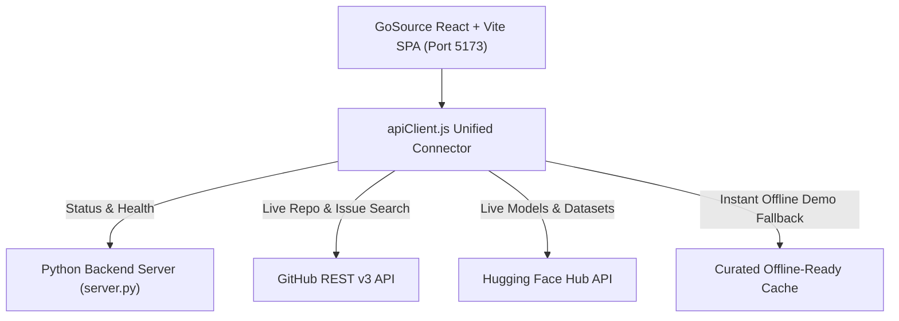

# 🚀 GoSource — Open Source Discovery Platform & Launchpad

> **Hackathon Problem Statement 20**: Open Source Finder  
> **Team / Creator**: ChiruAIHub  
> **Live Demo URL**: [https://right-midnight-ate-defense.trycloudflare.com](https://right-midnight-ate-defense.trycloudflare.com)  
> **GitHub Repository**: [https://github.com/ChiruAIHub/GoSource](https://github.com/ChiruAIHub/GoSource)

---

## 🌟 Executive Vision & Problem Statement

Millions of students, beginners, and aspiring developers want to contribute to open source, but face severe friction:
1. **Repository Overwhelm**: Searching GitHub yields thousands of complex enterprise monorepos without clear beginner entry points.
2. **Finding Actionable Issues**: Locating active, unassigned, beginner-friendly issues (`good first issue`) across diverse repos is tedious and manual.
3. **AI/ML Silos**: AI developers must juggle Hugging Face (models) and Kaggle (datasets) separately from traditional code hosting platforms.
4. **Contribution Anxiety**: Beginners lack confidence on how to fork, branch, test, and write pull requests that maintainers will actually merge.

**GoSource** unifies the best developer experiences of **GitHub** (code collaboration), **Hugging Face** (open-weights AI models & inference), and **Kaggle** (benchmark datasets & tier gamification) into a single, cohesive, modern platform.

---

## 🛠️ Architecture & Tech Stack



* **Frontend**: React 19, Vite, Tailwind CSS v4, Lucide React
* **Backend**: Python 3.12 zero-dependency HTTP server with REST endpoints & SPA static file serving
* **APIs**: GitHub REST API v3, Hugging Face Hub API, and Kaggle open dataset schemas
* **Design Identity**: Deep space navy (`#080b11`, `#0c1222`), electric cyan (`#06b6d4`), and modern violet (`#8b5cf6`) accents with frosted glassmorphism cards.

---

## 🎯 10 Core Features Implemented

1. **Project Discovery**: Filter open-source repositories by language (Python, TypeScript, Go, Rust), domain (Web, AI/ML, Backend, Systems), and difficulty level.
2. **Beginner-Friendly Issue Finder**: Direct filter for `good first issue`, `documentation`, and `help wanted` tags with mentorship indicators and estimated resolution times.
3. **Skill-Based Recommendations**: Interactive skill matrix where selecting skills (e.g. Python, React, FastAPI) recalculates project match scores in real-time.
4. **AI/ML Hub (Hugging Face)**: Discover open-weights models (DeepSeek-V3, FLUX.1, Llama 3.3, Qwen 2.5), view parameter sizes, and copy ready-to-run Python inference scripts.
5. **Dataset Explorer (Kaggle & Hugging Face)**: Explore curated datasets with live interactive sample-record preview tables, schema tags, and usability scores.
6. **Unified Smart Search (`Ctrl + K`)**: Command palette searching across repos, issues, models, and datasets simultaneously with keyboard navigation.
7. **Project Deep-Dive Modal**: Interactive drawer showing architecture overviews, terminal setup commands (`git clone`), and checklist from `CONTRIBUTING.md`.
8. **Beginner Learning Hub**: Interactive Zero-to-Hero guides for Git, step-by-step pull request anatomy, and open-source etiquette.
9. **Personalized Dashboard**: User tier progress ring (inspired by Kaggle), 4-week contribution streak calendar (inspired by GitHub), and bookmarked items manager.
10. **Contribution Roadmap**: 5-step checklist guiding students from discovering an issue to landing their first merged PR, with persistent localStorage progress.

---

## 🔌 Backend Connector & Live API Architecture

GoSource features a resilient API service layer located at `src/services/apiClient.js` that supports three configurable operational pipelines via the **API Connector Modal** in the navbar:

| Mode | Pipeline Behavior | Ideal For |
| :--- | :--- | :--- |
| **Hybrid (Default)** | Queries live GitHub and Hugging Face APIs with instantaneous fallback to verified curated cache upon rate-limiting. | Production & Live Presentations |
| **Live APIs Only** | Queries `api.github.com` and `huggingface.co/api` directly in real-time. | Real-time ecosystem queries |
| **Curated Demo** | Strictly uses high-speed local data with rich interactive metadata. | Offline presentations without WiFi |

### Local Backend Server API Endpoints (`server.py`)
* `GET /api/status` — Returns engine health, active model capabilities, and server metrics.
* `GET /api/health` — Heartbeat verification check.
* `GET /` — Serves the compiled production React/Vite single-page application.

---

## 🏃 Quickstart Guide

### Option 1: Run Pre-Built Production Server (Recommended)
```bash
python server.py
```
*Open [https://right-midnight-ate-defense.trycloudflare.com](https://right-midnight-ate-defense.trycloudflare.com) in your browser.*

### Option 2: Run Development Server (with Hot Reloading)
```bash
npm install
npm run dev
```

### Option 3: Rebuild Frontend
```bash
npm run build
```
